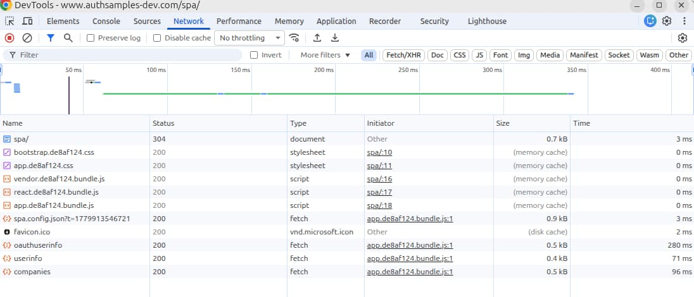

# How to Run the React SPA

Previously I provided a <a href='final-spa-overview.mdx'>Final SPA Overview</a> with the main high-level architecture behaviours. Next I show how to run the final SPA on a development computer in a couple of different configurations.

### Step 1: Download the GitHub Code

Clone the GitHub repository and browse the README, to make sure your local computer has the required tools.

```bash
git clone https://github.com/gary-archer/oauth.websample.final
```


### Step 2: Implement Administrator Setup

This blog's code samples use <a href="developer-ssl-setup.mdx#real-world-oauth-development-urls">Real World OAuth Development URLs</a> on a local computer, which requires some administrator setup. To enable DNS lookup of the SPA subdomains, add the following DNS entry to your hosts file:

```markdown
127.0.0.1 www.authsamples-dev.com
```

In the root folder, run the following commands to create <a href="developer-ssl-setup.mdx#creating-ssl-certificates-and-keys">OpenSSL Development Certificates</a> in your preferred secrets folder. You then need to <a href="developer-ssl-setup.mdx#configure-operating-system-trust">Configure HTTPS Trust</a>, to prevent security warnings about untrusted certificates.

```bash
export SECRETS_FOLDER="$HOME/secrets"
mkdir "$SECRETS_FOLDER"
./certs/create.sh
```

The SPA runs on port 443, like deployed systems. To use such ports, you may also need to grant permissions to Node.js, with a command such as the following:

```bash
sudo setcap 'cap_net_bind_service=+ep' $(which node)
```

### Step 3: Build and Run the SPA

Open a terminal and run the following command from the root folder, to build and run the SPA's code for development. Running the SPA does not require administrator privileges.

```bash
./start.sh
```

The SPA terminal window builds JavaScript bundles and serves them using a development web server on port 443:


### Step 4: Sign In to the SPA

You will then be prompted to sign in, and can do so with the following test credential:

- User: *guestuser@example.com*
- Password: *GuestPassword1*

After login, the SPA sends an HttpOnly encrypted cookie containing an AWS Cognito access token to the AWS API gateway. The OAuth Proxy decrypts the cookie and forwards the access token to lambda-based APIs. These API endpoints validate the access token and implement claims-based authorization. For authorized requests, the SPA receives and renders the API's response data:


### Step 5: View Secure Cookies

When the SPA makes API requests it sends a short-lived access token encrypted into an *HttpOnly SameSite=strict Secure* cookie. Since Cognito uses RS256 JWTs, the cookie size is around 1.5KB, which is comfortably below browser 4KB cookie size limits. You can use browser tools to view secure cookies, which are for the backend for frontend subdomain and not the web origin. The SPA does not require any cookies to download static content, and does not use cookies when the user performs web navigations:


### Step 6: View Updated SPA Configuration

In earlier samples, the SPA performed its own JavaScript code flow. This work is now done by remote token handler components, and the SPA configuration is therefore simplified, primarily to a backend for frontend base URL:

```json
{
    "bffBaseUrl": "https://bff.authsamples-dev.com",
    "delegationIdClaimName": "origin_jti"
}
```

### Step 7: Run a Release Build

You can run some scripts to test a release deployment. The *build.sh* script produces JavaScript release bundles ready for deployment to a CDN. The *deploy.sh* script runs a Docker container that uses Express to serve minimized static content. The *teardown.sh* script stops the Docker container.

```bash
./deployment/docker/build.sh
./deployment/docker/deploy.sh
./deployment/docker/teardown.sh
```

After running the *build.sh* and *deploy.sh* scripts, browse to *https://www.authsamples-dev.com/spa/* and test a release deployment of the SPA. Release builds use web resource optimizations, like minification, compression and browser caching, but otherwise integrate with the browser using the same technical mechanisms as development builds.



### Local API Setup

Web developers only need to work on a single component, the SPA, and that is the preferred development setup. If required, you can also connect the SPA to an API on the local computer, though you then need to manage cookies for this routing. One way to do so is to run a local token handler. To do so, first ensure that a Docker engine is installed, and also the *envsubst* tool.

### Step A: Run the API

Select one of this blog's final APIs from the below list, and follow its instructions, to run the API on port 446:

- <a href='api-architecture-node.mdx'>Node.js API</a>
- <a href='net-core-code-sample-overview.mdx'>.NET API</a>
- <a href='java-spring-boot-api-overview.mdx'>Java Spring Boot API</a>

### Step B: Update DNS

Next, add the API subdomain and local backend for frontend domain to your computer's hosts file:

```markdown
127.0.0.1  localhost www.authsamples-dev.com api.authsamples-dev.com bfflocal.authsamples-dev.com
```

### Step C: Run the SPA against a Local API

To make the SPA connect to one of this blog's final APIs, first ensure that the API is running. Then use a *LOCALAPI* parameter when running the scripts described earlier:

```bash
export SECRETS_FOLDER="$HOME/secrets"
export LOCALAPI=true
./start.sh
```

This runs some utility token handler components in a small Docker Compose network. You can study the deployment resources to get a feel for how this works. The SPA's configuration then routes to the API via the local backend for frontend rather than the cloud BFF:

```json
{
    "bffBaseUrl": "https://bfflocal.authsamples-dev.com:444",
    "delegationIdClaimName": "origin_jti"
}
```

### Step D: Use the SPA and API

When you now use the SPA it calls the local API rather than a cloud API. The API behaviour includes logging output that is explained in later posts, under this blog's API theme.


### Step E: Free Docker Resources

To free resources in the Docker Compose network, run the following command:

```bash
./teardown.sh
```

### Where Are We?

I explained how to run the final SPA code sample, which has more moving parts than earlier code samples. The SPA can be run as a single component under development with a pure SPA developer experience. The app is in control of its own OAuth and OpenID Connect flow. After user logins, the SPA calls deployed API components using secure cookies.

### Next

- Next I explain some <a href='reactjs-codingkeypoints.mdx'>Final SPA Code Details</a>.
- For a list of all blog posts see the <a href='index.mdx'>Index Page</a>.
