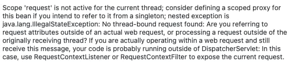
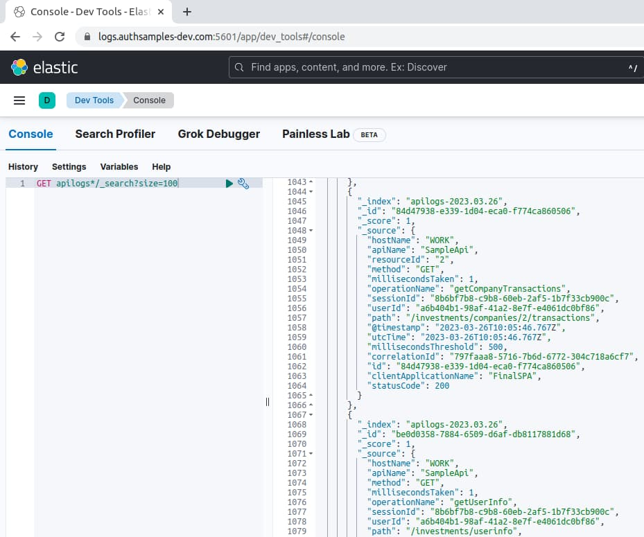

# Java API - Code Details

The previous post described this blog's <a href='spring-boot-api-oauth-integration.mdx'>Spring Boot API OAuth Integration</a>. Next I explain some final implementation details.

### Code Structure

The code for the API consists of business logic and supporting infrastructure code. In a real API you would want to write the infrastructure code only once and then scale the valuable business logic.

<div className='smallimage'>
    
</div>

### Application Startup Logic

The API entry point is defined in the *FinalApiApplication* class. I use Spring Boot extensibility points via the following classes from the *host* folder, which are instantiated when the API starts:

| Class | Description |
| ----- | ----------- |
| ApplicationInitializer | Logic before Spring's component system is initialised. |
| HttpServerConfiguration | Logic after Spring's component system is initialised. |

### Dependency Composition

The main responsibility of these objects is to read the API's JSON configuration settings and use them to configure the HTTP server and register dependencies with the Spring container:

```java
@Override
public void initialize(ConfigurableApplicationContext context) {

    var reader = new JsonFileReader();
    var configuration = reader.readFile("api.config.json", Configuration.class).join();

    loggerFactory.configure(configuration.getLogging());

    this.configureHttpListener(configuration.getApi());
    this.configureHttpDebugging(configuration.getApi());
    this.configureSsl(configuration);

    var container = context.getBeanFactory();
    container.registerScope(CustomRequestScope.NAME, new CustomRequestScope());

     new CompositionRoot(container)
        .addConfiguration(configuration)
        .addLogging(configuration.getLogging(), loggerFactory)
        .addExtraClaimsProvider(new ExtraClaimsProviderImpl(container))
        .register();
}
```

### Middleware

Startup code creates various middleware classes and Spring calls most of them *interceptors*. These are natural singletons, and some of them need to be registered with the container:

```java
@Override
    public void addInterceptors(InterceptorRegistry registry) {

        var loggingInterceptor = new LoggingInterceptor(this.context.getBeanFactory());
        registry.addInterceptor(loggingInterceptor)
                .addPathPatterns(ResourcePaths.ALL);

        var headerInterceptor = new CustomHeaderInterceptor(this.loggingConfiguration.getApiName());
        registry.addInterceptor(headerInterceptor)
                .addPathPatterns(ResourcePaths.ALL);
}
```

The role of each middleware object is summarised below:

| Middleware Class | Responsibility |
| ---------------- | -------------- |
| LoggingInterceptor | Manages the log entry for each API request, then logs request and response details. |
| CustomHeaderInterceptor | Allows advanced client side testing of APIs via custom headers. |
| UnhandledExceptionHandler | A central place for handling exceptions, adding error details to logs, and producing the client error response. |

### Single Threaded Code

For APIs with small dependency graphs, I like to reduce the likelihood of parallel requests impacting each other. I do this by giving each request its own independent object instances. The API uses a request scope for REST specific objects, or a prototype scope for domain logic classes:

```java
@RestController()
@Scope(value = CustomRequestScope.NAME)
@RequestMapping(value = "api/companies")
public class CompanyController {
    ...    
}

@Service
@Scope(value = ConfigurableBeanFactory.SCOPE_PROTOTYPE)
public class CompanyService {
    ...
}
```

### High Throughput Requirement

This blog's earlier Node.js and .NET APIs are *Non Blocking* and use an async await syntax, to prevent threads being tied up during I/O completion. The Node.js and .NET APIs use *Promises* and *Tasks* to achieve this, with only a small impact on its overall code. In Java, the same requirement exists.

### Java Non Blocking API Solutions

There are a few approaches to using async await code in Java, summarised below. Each of these has very different behaviour:

| Solution | Characteristics |
| -------- | --------------- |
| [Reactor](https://projectreactor.io/docs/core/release/reference/#context) | A streaming interface to return large collections of resources to clients in chunks. |
| [Completable Futures](https://www.baeldung.com/java-completablefuture) | Non blocking I/O in line with Node.js and .NET. |
| [Virtual Threads](https://www.azul.com/blog/jdk-21-delivers-virtual-threads-other-new-features-and-long-term-support/) | Virtual threads in Java 21+ are used to only block a lightweight thread and return the main OS thread to the thread pool. |

The code sample uses virtual threads, with the following setting in the *application properties file*:

```markdown
spring.threads.virtual.enabled=true
```

### Async Await

Most languages, including Kotlin, have an await keyword, which creates a state machine object that captures variables in closures, but Java does not support this. In Kotlin you can write non-blocking code like this and code remains readable when there are multiple async calls.

```kotlin
import kotlinx.coroutines.future.await

class JsonFileReader {

    private suspend fun readJsonFromFile(filePath: String): String {

        val path = Paths.get(filePath)
        val bytes = AsyncFiles.readAllBytes(path).await()
        return String(bytes)
    }
}
```

Before upgrading to Java 21 and Spring Boot 3.2, the API ran asynchronously using completable futures, which led to complex code with nested callbacks. Over time, this type of unreadable syntax would lead to bugs in a real API:

```java
public CompletableFuture<CompanyTransactions> getCompanyTransactions(int companyId) {

    var breakdown = this.logEntry.createPerformanceBreakdown("getCompanyTransactions");

    return this.jsonReader.readFile("data/companyList.json", Company[].class)
            .handle((companies, companiesException) ->
                    this.getAndFilterCompanies(
                            companyId,
                            companies,
                            breakdown,
                            companiesException))
            .thenCompose(foundCompany ->
                    this.jsonReader.readFile("data/companyTransactions.json", CompanyTransactions[].class)
                    .handle((transactions, transactionsException) ->
                            this.getAndFilterTransactions(
                                    companyId,
                                    foundCompany,
                                    transactions,
                                    breakdown,
                                    transactionsException)));
}
```

With virtual threads the code is written synchronously and is much more readable, yet continues to manage I/O efficiently. Ideally though, I would prefer to use the same async design pattern for Node.js, .NET and Java APIs.

```java
public CompanyTransactions getCompanyTransactions(int companyId) {

    try (var breakdown = this.logEntry.createPerformanceBreakdown("getCompanyTransactions")) {

        var companies = this.jsonReader.readFile("data/companyList.json", Company[].class);
        var foundCompany = this.getAndFilterCompanies(companyId, companies);

        var transactions = this.jsonReader.readFile("data/companyTransactions.json", CompanyTransactions[].class);
        return this.getAndFilterTransactions(companyId, foundCompany, transactions);
    }
}
```

### Custom Request Scope

When you use completable futures, the code switches threads when code resumes after an async operation. When the new thread tries to resolve objects, it fails because the *RequestContextHolder* class uses thread local storage for request scoped objects, resulting in the following cryptic error: 



To solve this problem I created a [Spring Boot Custom Scope](https://www.baeldung.com/spring-custom-scope) that stores request scoped objects in the *HttpServletRequest* object. Now that the API uses virtual threads, the custom scope is no longer strictly needed, but I left it in place, so that the API manages  request scoped objects in the same way as Node.js and .NET APIs.

### Logging Implementation

I implement API logging with classes in the *logging* folder, whose end goal is to enable <a href='api-technical-support-analysis.mdx'>useful technical support queries by people</a>. The *LogEntry* is a natural request scoped object so I use the following factory method to create it and make it injectable when another object first accesses the *LogEntry* during the lifetime of an API request:

```java
@Component
@Scope(value = ConfigurableBeanFactory.SCOPE_SINGLETON)
public class LogEntryInjector {

    private final LoggerFactoryImpl loggerFactory;

    public LogEntryInjector(LoggerFactoryImpl loggerFactory) {
        this.loggerFactory = loggerFactory;
    }

    @Bean
    @Scope(value = CustomRequestScope.NAME)
    public LogEntryImpl createLogEntry() {
        return this.loggerFactory.createLogEntry();
    }
}
```

The *LogEntry* is then accessed by interceptor objects which contribute data to request logs and audit logs at various points during the request lifecycle:

```java
public final class LoggingInterceptor implements HandlerInterceptor {

    private final BeanFactory container;
    private final LoggerFactory loggerFactory;

    public LoggingInterceptor(BeanFactory container, LoggerFactory loggerFactory) {
        this.container = container;
        this.loggerFactory = loggerFactory;
    }

    @Override
    public boolean preHandle(
            @NonNull HttpServletRequest request,
            @NonNull HttpServletResponse response,
            @NonNull Object handler) {

        try {

            var logEntry = this.container.getBean(LogEntryImpl.class);
            logEntry.start(request);

            @SuppressWarnings("unchecked")
            var pathVariables = (Map<String, String>)
                    request.getAttribute(HandlerMapping.URI_TEMPLATE_VARIABLES_ATTRIBUTE);
            logEntry.setResourceId(pathVariables);

        } catch (Exception filterException) {

            var exceptionHandler = this.container.getBean(UnhandledExceptionHandler.class);
            exceptionHandler.handleFilterException(request, response, filterException);
            return false;
        }

        return true;
    }

    @Override
    public void afterCompletion(
            @NonNull HttpServletRequest request,
            @NonNull HttpServletResponse response,
            @NonNull Object handler,
            Exception ex) {

        try {

            var logEntry = this.container.getBean(LogEntryImpl.class);
            var handlerMappings = this.container.getBean(RequestMappingHandlerMapping.class);
            logEntry.end(request, response, handlerMappings);

            var requestLogger = loggerFactory.getRequestLogger();
            if (requestLogger != null) {
                requestLogger.info("info", logEntry.getRequestLog());
            }

            var auditLogger = loggerFactory.getAuditLogger();
            if (auditLogger != null) {
                auditLogger.info("info", logEntry.getAuditLog());
            }

            CustomRequestScope.removeAll();

        } catch (Exception filterException) {

            var exceptionHandler = this.container.getBean(UnhandledExceptionHandler.class);
            exceptionHandler.handleFilterException(request, response, filterException);
        }
    }
}
```

It is also possible to inject the *LogEntry* into business logic. For example, the below repository object contributes performance instrumentation:

```java
@Repository
@Scope(value = ConfigurableBeanFactory.SCOPE_PROTOTYPE)
public class CompanyRepository {

    private final JsonFileReader jsonReader;
    private final LogEntry logEntry;

    public CompanyRepository(JsonFileReader jsonReader, LogEntry logEntry) {
        this.jsonReader = jsonReader;
        this.logEntry = logEntry;
    }

    public CompletableFuture<List<Company>> getCompanyList() {

        try (var breakdown = this.logEntry.createPerformanceBreakdown("getCompanyList")) {

            var companies = await(this.jsonReader.readFile("data/companyList.json", Company[].class));
            return completedFuture(Arrays.stream(companies).collect(Collectors.toList()));
        }
    }
}
```

Logging objects write to a JSON log file and, if you follow the <a href='log-aggregation-setup.mdx'>Log Aggregation Setup</a>, request logs and audit logs will automatically flow to Elasticsearch:



### Error Handling Implementation

The API implements this blog's <a href='error-handling-and-supportability.mdx'>Error Handling and Supportability</a> design. By default all errors escape to the global exception handler class, whose role is to log errors and return an error response to the caller:

```java
@RestControllerAdvice
public final class UnhandledExceptionHandler {

    private final BeanFactory container;
    private final String apiName;

    public UnhandledExceptionHandler(
            BeanFactory container,
            LoggingConfiguration configuration) {

        this.container = container;
        this.apiName = configuration.getApiName();
    }

    @ExceptionHandler(value = Throwable.class)
    public ResponseEntity<String> handleException(HttpServletRequest request, Throwable ex) {

        var logEntry = this.container.getBean(LogEntryImpl.class);
        var clientError = this.handleError(ex, logEntry);
        return new ResponseEntity<>(clientError.toResponseFormat().toString(), clientError.getStatusCode());
    }
}
```

The art of good error handling is to design good error objects that contain useful fields to both callers of the API and technical support staff. Development error output has a productive and readable format that matches the rendering of production logs. Each request log entry includes context like the current user, session, API and operation.

```json
{
  "type" : "request",
  "id" : "e8bc49d0-1cb5-47b7-bb86-96ce267d36cf",
  "utcTime" : "2026-11-16T18:43:15.105540274Z",
  "apiName" : "FinalApi",
  "operationName" : "getCompanyList",
  "hostName" : "UBUNTU",
  "method" : "GET",
  "path" : "/investments/companies",
  "clientId" : "7q5pope8rki7okarj2u8l4in7o",
  "userId" : "06e3c525-33d1-47ec-97be-03d8affc3726",
  "statusCode" : 500,
  "errorCode" : "exception_simulation",
  "errorId" : 53769,
  "millisecondsTaken" : 9,
  "correlationId" : "eb548ca4-c1d0-4418-8c66-ca731263dbd1",
  "sessionId" : "d94e8bfb-4ec2-4ffd-9f86-703e647a1476",
  "errorData" : {
    "statusCode" : 500,
    "clientError" : {
      "code" : "exception_simulation",
      "message" : "An exception was simulated in the API",
      "area" : "FinalApi",
      "id" : 53769,
      "utcTime" : "2026-11-16T18:43:15.110211896Z"
    },
    "serviceError" : {
      "errorCode" : "exception_simulation",
      "stack" : [
        "com.authsamples.api.middleware.errors.ErrorFactory.createServerError(ErrorFactory.java:20)",
        "com.authsamples.api.middleware.errors.CustomHeaderInterceptor.preHandle(CustomHeaderInterceptor.java:30)",
        "org.springframework.web.servlet.HandlerExecutionChain.applyPreHandle(HandlerExecutionChain.java:145)",
        "org.springframework.web.servlet.DispatcherServlet.doDispatch(DispatcherServlet.java:957)",
        "org.springframework.web.servlet.DispatcherServlet.doService(DispatcherServlet.java:866)",
        "org.springframework.web.servlet.FrameworkServlet.processRequest(FrameworkServlet.java:1000)",
        "org.springframework.web.servlet.FrameworkServlet.doGet(FrameworkServlet.java:892)",
        "jakarta.servlet.http.HttpServlet.service(HttpServlet.java:622)",
        "org.springframework.web.servlet.FrameworkServlet.service(FrameworkServlet.java:874)",
        "jakarta.servlet.http.HttpServlet.service(HttpServlet.java:710)",
        "org.apache.catalina.core.ApplicationFilterChain.doFilter(ApplicationFilterChain.java:132)",
        "org.apache.tomcat.websocket.server.WsFilter.doFilter(WsFilter.java:59)",
        "org.apache.catalina.core.ApplicationFilterChain.doFilter(ApplicationFilterChain.java:111)",
        "org.springframework.web.filter.CompositeFilter$VirtualFilterChain.doFilter(CompositeFilter.java:108)",
        "org.springframework.security.web.FilterChainProxy.lambda$doFilterInternal$2(FilterChainProxy.java:235)",
        "org.springframework.security.web.FilterChainProxy$VirtualFilterChain.doFilter(FilterChainProxy.java:378)",
        "org.springframework.security.web.access.intercept.AuthorizationFilter.doFilter(AuthorizationFilter.java:101)",
        "org.springframework.security.web.FilterChainProxy$VirtualFilterChain.doFilter(FilterChainProxy.java:387)",
        "org.springframework.security.web.authentication.AnonymousAuthenticationFilter.doFilter(AnonymousAuthenticationFilter.java:101)",
        "org.springframework.security.web.FilterChainProxy$VirtualFilterChain.doFilter(FilterChainProxy.java:387)",
        "org.springframework.security.web.servletapi.SecurityContextHolderAwareRequestFilter.doFilter(SecurityContextHolderAwareRequestFilter.java:181)",
        "org.springframework.security.web.FilterChainProxy$VirtualFilterChain.doFilter(FilterChainProxy.java:387)",
        "com.authsamples.api.middleware.oauth.CustomAuthenticationFilter.doFilterInternal(CustomAuthenticationFilter.java:74)",
        "org.springframework.web.filter.OncePerRequestFilter.doFilter(OncePerRequestFilter.java:116)",
        "org.springframework.security.web.FilterChainProxy$VirtualFilterChain.doFilter(FilterChainProxy.java:387)",
        "org.springframework.security.web.context.request.async.WebAsyncManagerIntegrationFilter.doFilterInternal(WebAsyncManagerIntegrationFilter.java:62)",
        "org.springframework.web.filter.OncePerRequestFilter.doFilter(OncePerRequestFilter.java:116)",
        "org.springframework.security.web.FilterChainProxy$VirtualFilterChain.doFilter(FilterChainProxy.java:387)",
        "org.springframework.security.web.FilterChainProxy.doFilterInternal(FilterChainProxy.java:237)",
        "org.springframework.security.web.FilterChainProxy.doFilter(FilterChainProxy.java:195)",
        "org.springframework.web.filter.CompositeFilter$VirtualFilterChain.doFilter(CompositeFilter.java:113)",
        "org.springframework.web.filter.ServletRequestPathFilter.doFilter(ServletRequestPathFilter.java:52)",
        "org.springframework.web.filter.CompositeFilter$VirtualFilterChain.doFilter(CompositeFilter.java:113)",
        "org.springframework.web.filter.CompositeFilter.doFilter(CompositeFilter.java:74)",
        "org.springframework.security.config.annotation.web.configuration.WebSecurityConfiguration$CompositeFilterChainProxy.doFilter(WebSecurityConfiguration.java:317)",
        "org.apache.catalina.core.ApplicationFilterChain.doFilter(ApplicationFilterChain.java:111)",
        "org.springframework.web.filter.RequestContextFilter.doFilterInternal(RequestContextFilter.java:100)",
        "org.springframework.web.filter.OncePerRequestFilter.doFilter(OncePerRequestFilter.java:116)",
        "org.apache.catalina.core.ApplicationFilterChain.doFilter(ApplicationFilterChain.java:111)",
        "org.springframework.web.filter.FormContentFilter.doFilterInternal(FormContentFilter.java:93)",
        "org.springframework.web.filter.OncePerRequestFilter.doFilter(OncePerRequestFilter.java:116)",
        "org.apache.catalina.core.ApplicationFilterChain.doFilter(ApplicationFilterChain.java:111)",
        "org.springframework.web.filter.CharacterEncodingFilter.doFilterInternal(CharacterEncodingFilter.java:199)",
        "org.springframework.web.filter.OncePerRequestFilter.doFilter(OncePerRequestFilter.java:116)",
        "org.apache.catalina.core.ApplicationFilterChain.doFilter(ApplicationFilterChain.java:111)",
        "org.apache.catalina.core.StandardWrapperValve.invoke(StandardWrapperValve.java:164)",
        "org.apache.catalina.core.StandardContextValve.invoke(StandardContextValve.java:77)",
        "org.apache.catalina.authenticator.AuthenticatorBase.invoke(AuthenticatorBase.java:540)",
        "org.apache.catalina.core.StandardHostValve.invoke(StandardHostValve.java:115)",
        "org.apache.catalina.valves.ErrorReportValve.invoke(ErrorReportValve.java:86)",
        "org.apache.catalina.core.StandardEngineValve.invoke(StandardEngineValve.java:71)",
        "org.apache.catalina.connector.CoyoteAdapter.service(CoyoteAdapter.java:347)",
        "org.apache.coyote.http11.Http11Processor.service(Http11Processor.java:411)",
        "org.apache.coyote.AbstractProcessorLight.process(AbstractProcessorLight.java:71)",
        "org.apache.coyote.AbstractProtocol$ConnectionHandler.process(AbstractProtocol.java:1308)",
        "org.apache.tomcat.util.net.NioEndpoint$SocketProcessor.doRun(NioEndpoint.java:2202)",
        "org.apache.tomcat.util.net.SocketProcessorBase.run(SocketProcessorBase.java:74)",
        "java.base/java.lang.VirtualThread.run(VirtualThread.java:460)"
      ]
    }
  }
}
```

By default the exception handler treats unknown errors as general exceptions and returns a 500 response. For closer control of the response, the API's code can throw a *ServerError* or *ClientError* derived instance:

```java
private ClientError unauthorizedError(int companyId) {

    var message = String.format("Transactions for company %d were not found for this user", companyId);
    return ErrorFactory.createClientError(
            HttpStatus.NOT_FOUND,
            SampleErrorCodes.COMPANY_NOT_FOUND,
            message);
}
```

### Portability

The API uses some techniques that are a little different to many online Java examples. However, the design is very mainstream and provides a future-proof code setup that separates non-functional code from business logic. The code for this blog's Node.js and .NET APIs is almost identical.

### Where Are We?

I implemented some foundational code in Java without any blocking issues, and separated infrastructure from functional code. In a real API I could then focus on growing the business logic.

### Next

- Next I explain how to run some <a href='api-automated-tests.mdx'>API Automated Security Tests</a>.
- For a list of all blog posts see the <a href='index.mdx'>Index Page</a>.
